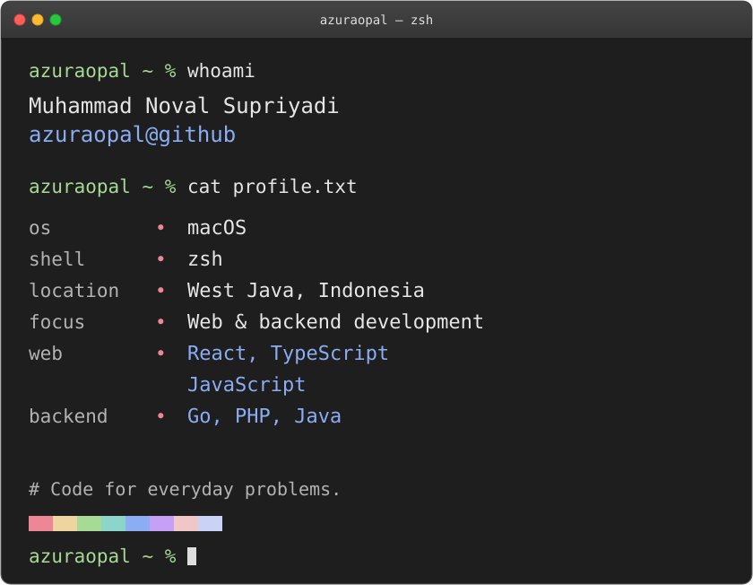
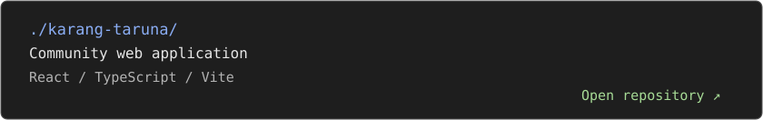
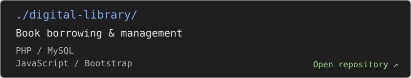
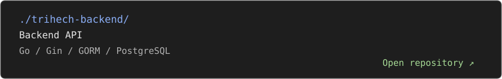

<picture>
  <source media="(max-width: 600px)" srcset="./assets/terminal-profile-mobile.svg">
  
</picture>

### `azuraopal ~ % ls -1 projects/`

<a href="https://github.com/azuraopal/karang-taruna">
<picture>
  <source media="(max-width: 600px)" srcset="./assets/karang-taruna-mobile.svg">
  
</picture>
</a>

<a href="https://github.com/azuraopal/perpustakaan_digital_SMKN1CIOMAS">
<picture>
  <source media="(max-width: 600px)" srcset="./assets/digital-library-mobile.svg">
  
</picture>
</a>

<a href="https://github.com/azuraopal/trihech-backend">
<picture>
  <source media="(max-width: 600px)" srcset="./assets/trihech-backend-mobile.svg">
  
</picture>
</a>

[View all repositories](https://github.com/azuraopal?tab=repositories)

Profile in plain text

**Muhammad Noval Supriyadi · @azuraopal**

West Java, Indonesia. Web and backend projects using React, TypeScript, JavaScript, Go, PHP, and Java.

- [Karang Taruna](https://github.com/azuraopal/karang-taruna): community web application using React, TypeScript, and Vite.
- [Digital Library](https://github.com/azuraopal/perpustakaan_digital_SMKN1CIOMAS): library management and book borrowing using PHP, MySQL, JavaScript, and Bootstrap.
- [Trihech Backend](https://github.com/azuraopal/trihech-backend): Go backend using Gin, GORM, and PostgreSQL.

